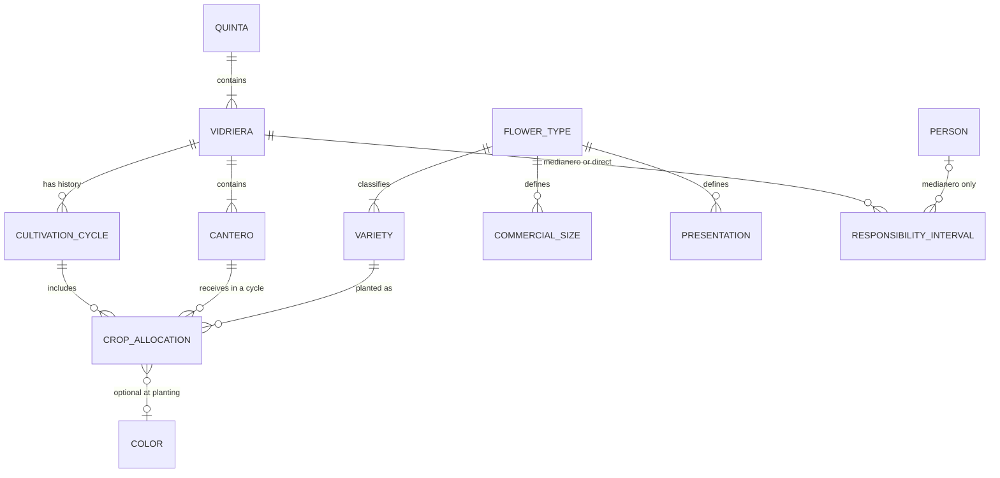
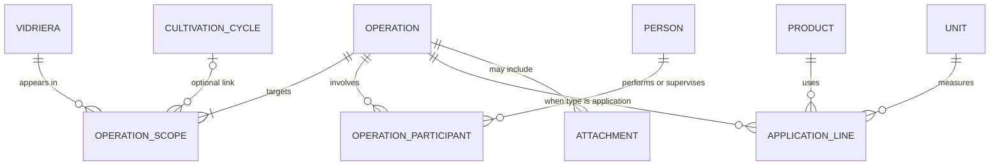

# Conceptual data model

This is the shared language for data ownership and relationships. It is not a SQL schema and not a list of tables to create in advance. Implement the entities when the feature that owns them is built.

Terms are defined in the [glossary](../product/GLOSSARY.md).

## Ownership

| Concept | Owning module | Introduced by |
| --- | --- | --- |
| Deployment protection and backup | Access | CORE-01 |
| Measurement dimension, unit | Measurement | CORE-02 |
| Person, role interval | People | CORE-03 |
| Quinta, vidriera, cantero | Production | PROD-01 |
| Flower type, variety, color, commercial size, presentation | Production | PROD-02 |
| Cultivation cycle | Production | PROD-03 |
| Crop allocation | Production | PROD-04 |
| Medianero assignment or direct-management interval | Production | PROD-05 |
| Product, product category | Product catalog | INV-01 |
| Operation, operation type, scope | Operations | OPS-01, OPS-03 |
| Type-specific operation details | Operations | OPS-02 |
| Operation participant | Operations | OPS-04 |
| Observation text | Operations | OPS-02 |
| Attachment | Operations | TRACE-02 |
| Harvest event, harvest measurement, quality class | Harvest | HARV-01, HARV-02 |
| Storage location, stock, movement | Inventory | INV-02, INV-03 |
| Supplier, purchase | Inventory | INV-04 |
| Cost record, allocation | Cost | COST-01, COST-02 |
| Harvest lot, box, box content | Commercial | COMM-01 |
| Customer, order | Commercial | COMM-02 |
| Dispatch | Commercial | COMM-03 |
| Sale, receipt | Commercial | COMM-04 |

Traceability views (TRACE-01, COMM-05, HARV-03, HARV-04, COST-03) do not own a parallel set of facts. They read the records above.

## Physical structure and time

A cantero does not store its current crop as the only copy. The allocation on the cycle is the historical fact.

## Operations

One operation row is visible from every vidriera in its scope. The cycle link sits on the scope so two vidrieras are not forced into one cycle.

## Harvest, inventory, and commerce

```mermaid
erDiagram
  CANTERO |o--o{ HARVEST_EVENT : "exact origin"
  VARIETY ||--o{ HARVEST_EVENT : "cut as"
  CULTIVATION_CYCLE ||--o{ HARVEST_EVENT : produces
  HARVEST_EVENT ||--o{ HARVEST_MEASUREMENT : measures
  HARVEST_EVENT }o--o{ HARVEST_LOT : "may be grouped"
  HARVEST_LOT }o--o{ BOX_CONTENT : "origin when known"
  BOX ||--|{ BOX_CONTENT : contains
  CUSTOMER ||--o{ ORDER : places
  ORDER ||--o{ ORDER_LINE : requests
  DISPATCH ||--o{ BOX : loads
  SALE ||--o{ SALE_LINE : prices
  SALE ||--o{ RECEIPT : "receives money"
  PRODUCT ||--o{ STOCK : "quantity at"
  STORAGE_LOCATION ||--o{ STOCK : holds
  STOCK ||--o{ INVENTORY_MOVEMENT : changes
```

A box content with no harvest lot is an explicit unknown origin, not a missing required field that the user must guess. A content line may reference more than one lot when flowers were mixed.

## Uniqueness and integrity

| Rule | Reason |
| --- | --- |
| Quinta name is unique. | The two properties, and any later property, need a stable identity. |
| Vidriera name is unique within a quinta. | Operators refer to sections by name. |
| Cantero label is unique within a vidriera. | Harvest and allocation must point at one bed. |
| At most one active cultivation cycle per vidriera. | Confirmed operating rule. |
| Cycle date ranges for the same vidriera do not overlap. | Two active periods would make history ambiguous. |
| A cycle's allocation refers only to canteros of that cycle's vidriera. | Prevents cross-section allocations. |
| An operation scope's cycle, when set, belongs to that scope's vidriera. | Prevents attaching work to another section's cycle. |
| At most one open responsibility interval per vidriera. | Either one medianero or direct management by Monteiro. Intervals do not overlap. |
| A unit belongs to one dimension. Conversion stays inside that dimension. | Confirmed measurement rule. |
| Product commercial name plus manufacturer is the duplicate check shown to the user. Exact uniqueness is case-insensitive on the commercial name when the manufacturer is empty. | Stops obvious duplicates without blocking two products that share a trade name and have different manufacturers. |
| A harvest event names a variety and a cycle. Exact origin also names one cantero of that vidriera. Several events may share that pair. | Variety-level partial harvests. |
| The same variety and color are not allocated twice to one cantero in one cycle. Different varieties on that cantero are allowed. | Multiple varieties per bed, without duplicate rows. |
| A box is on at most one dispatch. | A physical box is not loaded twice. |
| Monetary amounts store a currency. | ARS is the default, not an implicit global. |

Deleting a record that other history points at is rejected. The user deactivates a quinta, vidriera, person, product, unit, or customer instead.

## Temporal rules

- Physical records, people, products, and units have an active flag. Inactive records remain on historical links.
- Medianero assignments and person roles store start and optional end.
- Cycles store start and, once finalized, end. Finalized cycles stay readable.
- Operations, harvests, movements, purchases, dispatches, sales, and receipts store the business time of the event and the time the record was written.
- Closing or correcting a record does not rewrite an earlier assignment, cycle, or operation in place without leaving the previous values observable. Implementation can use an update with timestamps or an explicit correction. Silent replacement is not acceptable.

## Cross-module references

- Operations reference vidrieras, optional cycles, products, units, and people. They do not reference varieties, canteros, or stock.
- Harvest references a variety and a cycle, plus a cantero only when origin is exact. It does not reference boxes until a commercial feature links a lot.
- Inventory references products, units, locations, and suppliers. A movement may optionally cite an operation or a purchase. The citation is a link, not a second copy of the quantity.
- Cost references operations, cycles, vidrieras, products, and purchases. It stores whether a figure is actual or estimated, whether it is direct or indirect, and keeps purchaser, physical consumption, and economic responsibility separate.
- Commercial records reference harvests and cycles only through lots and box contents. A sale does not copy yield figures.

## Facts that are not entities

- Software accounts, a permission matrix, and mobile-specific clients. The MVP is single-user and desktop-first.
- A medianero contract or settlement formula.
- A sensor, schedule engine, or map geometry.
- A universal vara count per ramo. A presentation may store an explicit count for itself.
- A seeded variety, color, size, or quality-class list.
