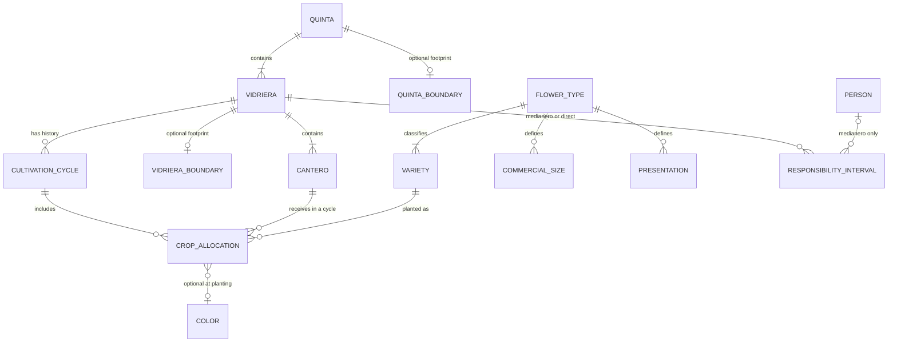
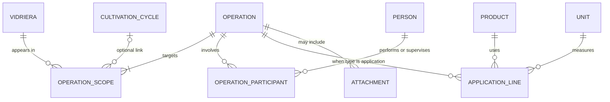
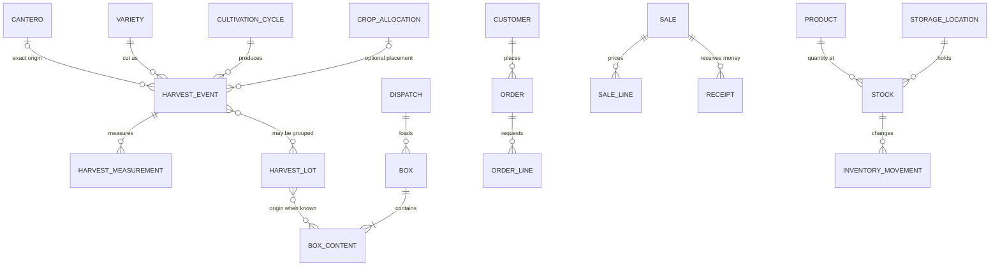

# Conceptual data model

This is the shared language for data ownership and relationships. It is not a SQL schema and not a list of tables to create in advance. Implement the entities when the feature that owns them is built.

Terms are defined in the [glossary](../product/GLOSSARY.md).

## Ownership

| Concept | Owning module | Introduced by |
| --- | --- | --- |
| Deployment protection and backup | Access | CORE-01 |
| Measurement dimension, unit | Measurement | CORE-02 |
| Person, role interval | People | CORE-03 |
| Quinta, vidriera, cantero, and their technical identifiers and operational codes | Production | PROD-01 |
| Quinta boundary, vidriera boundary | Production | PROD-06 |
| Flower type, variety, color, commercial size, presentation | Production | PROD-02 |
| Cultivation cycle | Production | PROD-03 |
| Crop allocation | Production | PROD-04 |
| Medianero assignment or direct-management interval | Production | PROD-05 |
| Product, product category | Product catalog | INV-01 |
| Operation, operation type, scope | Operations | OPS-01, OPS-03 |
| Recurring schedule revision, occurrence resolution | Operations | OPS-AUTO-01 |
| Type-specific operation details | Operations | OPS-02 |
| Operation participant | Operations | OPS-04 |
| Observation text | Operations | OPS-02 |
| Attachment | Operations | TRACE-02 |
| Harvest event, harvest measurement, quality class | Harvest | HARV-01, HARV-02 |
| Storage location, stock, movement | Inventory | INV-02, INV-03 |
| Supplier, purchase | Inventory | INV-04 |
| Cost record, allocation | Cost | COST-01, COST-02 |
| Harvest lot, box, box content | Commercial | COMM-01 |
| Customer, order | Commercial | COMM-02 |
| Dispatch | Commercial | COMM-03 |
| Sale, receipt | Commercial | COMM-04 |

Traceability views (TRACE-01, COMM-05, HARV-03, HARV-04, COST-03) do not own a parallel set of facts. They read the records above.

## Physical structure and time

A quinta and a vidriera each have an immutable technical identifier and a stable operational code. A cantero has an immutable technical identifier and a number from 1 to 4. Display labels and location notes are not keys. Codes are not reused after deactivation.

Geographic boundaries are optional and belong to the same Production records. A quinta has at most one boundary. A vidriera has at most one boundary, and only on a quinta that itself has a boundary. A cantero has none in PROD-06. The boundary is GeoJSON in WGS84 longitude and latitude. It is not a second quinta or vidriera, and it is not a measured area. The implemented storage is a nullable JSONB `boundary` column on `quintas` and `vidrieras`, added by Alembic revision `0002_production_boundaries`. The diagram below stays conceptual: there is no separate boundary table.

A cantero does not store its current crop as the only copy. The allocation on the cycle is the historical fact.

## Operations

One operation row is visible from every vidriera in its scope. The cycle link sits on the scope so two vidrieras are not forced into one cycle.

## Harvest, inventory, and commerce

A box content with no harvest lot is an explicit unknown origin, not a missing required field that the user must guess. A content line may reference more than one lot when flowers were mixed.

## Uniqueness and integrity

| Rule | Reason |
| --- | --- |
| Quinta operational code is unique, including inactive quintas, and is not reused. | Everyday identity must keep pointing at the same property. |
| Quinta descriptive name is unique. | The properties still need distinct names. The name is not the code. |
| Vidriera operational code is unique, including inactive vidrieras, and is not reused. The numeric part is unique within the parent quinta. | A code such as `VE-V001` must not be reassigned after deactivation. |
| Vidriera descriptive name is unique within a quinta. | Operators also refer to sections by name. The name is not the code. |
| Cantero number is unique within a vidriera and is one of 1, 2, 3, or 4. | Harvest and allocation must point at one bed. The derived label is not the key. |
| A quinta or vidriera boundary, when present, belongs to exactly one of those records. | The map must not invent a parallel place. |
| At most one active cultivation cycle per vidriera. | Confirmed operating rule. |
| Cycle date ranges for the same vidriera do not overlap. | Two active periods would make history ambiguous. |
| A cycle's allocation refers only to canteros of that cycle's vidriera. | Prevents cross-section allocations. |
| An operation scope's cycle, when set, belongs to that scope's vidriera. | Prevents attaching work to another section's cycle. |
| In OPS-01 the optional cycle is stored on the single-vidriera operation. It must belong to that vidriera. | The operation has one vidriera, so a separate scope row is not required yet. OPS-03 may move the link. |
| Schedule periods of the same vidriera and lighting or nylon type do not overlap. | Two programs must not claim the same day. A new revision does not overwrite the previous one. |
| One resolution exists per schedule series and occurrence date. | Repeating a confirmation does not create a second outcome. |
| At most one open responsibility interval per vidriera. | Either one medianero or direct management by Monteiro. Intervals do not overlap. |
| A unit belongs to one dimension. Conversion stays inside that dimension. | Confirmed measurement rule. |
| Product commercial name plus manufacturer is the duplicate check shown to the user. Exact uniqueness is case-insensitive on the commercial name when the manufacturer is empty. | Stops obvious duplicates without blocking two products that share a trade name and have different manufacturers. |
| A harvest event names a variety and a cycle. Exact origin also names one cantero of that vidriera. Several events may share that pair. An optional crop-allocation reference is set only when that placement is known, and several events may share it. | Variety-level partial harvests, without inventing an allocation. |
| In the first version, the same variety and color are not allocated twice to one cantero in one cycle. Different varieties, and a different color of the same variety, are allowed. | MVP simplification so one logical placement has one row. It is not a permanent claim that two physical portions cannot exist. See [OQ-28](../OPEN_QUESTIONS.md#oq-28). |
| A box is on at most one dispatch. | A physical box is not loaded twice. |
| Monetary amounts store a currency. | ARS is the default, not an implicit global. |

Deleting a record that other history points at is rejected. The user deactivates a quinta, vidriera, person, product, unit, or customer instead.

## Temporal rules

- Physical records, people, products, and units have an active flag. Inactive records remain on historical links.
- Medianero assignments and person roles store start and optional end.
- Cycles store the planting date as the start and, once finalized, the end. An empty end date means the cycle is active, so status is not stored separately. Finalized cycles stay readable under the same identifier.
- Cycle dates are calendar dates. Periods of one vidriera are inclusive and must not overlap, including a shared boundary day. PostgreSQL enforces that with a `btree_gist` exclusion constraint, because the comparison needs uuid equality together with a date range. An open cycle runs through every later date.
- A cycle's dates and notes may be corrected in place. The correction keeps the identifier and the vidriera, keeps an active cycle active, keeps a finalized cycle finalized, and is rejected when it would overlap another cycle. PROD-03 does not retain the previous values. An audit trail for those corrections is deferred.
- Operations, harvests, movements, purchases, dispatches, sales, and receipts store the business time of the event and the time the record was written.
- A recurring schedule is a series of revisions. Each revision keeps the clock times that apply between its effective dates. A later edit starts a new revision; it does not change the expected times of a day already covered. A paused revision does not generate occurrences. Clock times are civil times interpreted in America/Argentina/Buenos_Aires. Stored instants are timezone-aware and do not repeat that timezone on every row.
- A resolution copies the expected start and end when a person confirms the occurrence or records that it did not happen. Correcting the actual interval does not change those expected timestamps. An unverified occurrence is calculated; it is not a completed operation. The future check uses a five-minute tolerance in the application, because a database check against the current time would fail a stored row on the next day.
- Closing or correcting any other record does not rewrite an earlier assignment or operation in place without leaving the previous values observable. Implementation can use an update with timestamps or an explicit correction. Silent replacement is not acceptable.

## Cross-module references

- Operations reference vidrieras, optional cycles, products, units, and people. They do not reference varieties, canteros, or stock.
- Harvest references a variety and a cycle, plus a cantero only when origin is exact. It does not reference boxes until a commercial feature links a lot.
- Inventory references products, units, locations, and suppliers. A movement may optionally cite an operation or a purchase. The citation is a link, not a second copy of the quantity.
- Cost references operations, cycles, vidrieras, products, and purchases. It stores whether a figure is actual or estimated, whether it is direct or indirect, and keeps purchaser, physical consumption, and economic responsibility separate.
- Commercial records reference harvests and cycles only through lots and box contents. A sale does not copy yield figures.

## Facts that are not entities

- Software accounts, a permission matrix, and mobile-specific clients. The MVP is single-user and desktop-first.
- A medianero contract or settlement formula.
- A separate map entity, a stored satellite image, or a cantero polygon. Quinta and vidriera boundaries are optional geometries on the production records.
- A sensor or a schedule engine.
- A universal vara count per ramo. A presentation may store an explicit count for itself.
- A seeded variety, color, size, or quality-class list.
