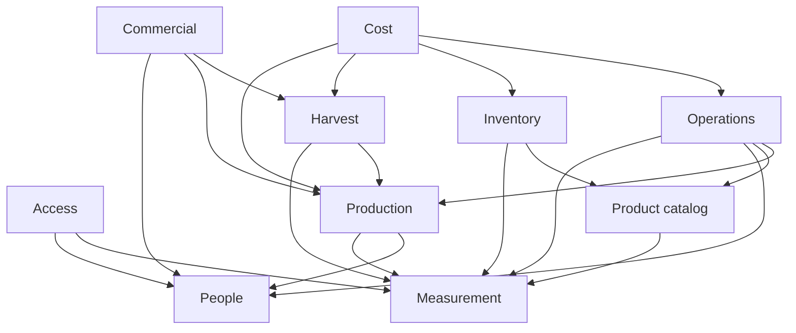

# Module dependencies

Modules are boundaries inside the modular monolith. They are not services. Create a module's code when the first feature in it is implemented.

## Modules

| Module | Responsibility | Must not own |
| --- | --- | --- |
| Access | The desktop shell, health, basic deployment protection, and backup | Business roles, accounts, vidrieras, operations |
| Measurement | Dimensions, units, conversion | Quantities of particular events |
| People | Persons and role intervals | Login credentials, vidriera assignments |
| Production | Quintas, vidrieras, canteros, crops, varieties, cycles, allocations, medianero assignments | Operations, harvest quantities |
| Product catalog | Products and categories | Stock balances |
| Operations | Operations, scopes, type-specific data, participants, attachments | Yield totals, stock withdrawals |
| Harvest | Harvest events, measurements, quality classes, yield and comparison reads | Box packing, prices |
| Inventory | Locations, stock, movements, suppliers, purchases | Application records |
| Cost | Cost lines and allocations, unit-economics reads | Sales invoices |
| Commercial | Lots, boxes, customers, orders, dispatch, sales, receipts, origin reads | Cultivation operations |

Traceability is a read behavior of Operations in Stage 1 (TRACE-01, TRACE-02) and of Commercial later (COMM-05). It is not a module with its own copies of operations.

## Allowed direction

Arrows mean "may read or reference". A module does not write another module's records except through that module's own rules.

Access is required by every user-facing feature. It is omitted from the later arrows to keep the diagram readable.

## Rules

- Production does not import inventory or commercial code. A cycle exists without a sale.
- Operations do not create inventory movements. COST-01 and INV-03 may link to an operation after the fact.
- Harvest does not require a box. Commercial links to harvest when origin is known.
- Cost reads quantities. It does not change them.
- Yield and margin screens compute from stored inputs and show the definition. They do not persist a second official total that can drift, except when an allocation method is itself a recorded decision (COST-02). That decision stores the method and the inputs.
- Future IoT or voice adapters, if they are ever built, call the same module rules. They do not write tables directly.

## Feature-to-module map

| Features | Module |
| --- | --- |
| CORE-01 | Access |
| CORE-02 | Measurement |
| CORE-03 | People |
| PROD-01 – PROD-05 | Production |
| INV-01 | Product catalog |
| INV-02 – INV-04 | Inventory |
| OPS-01 – OPS-04, TRACE-01, TRACE-02 | Operations |
| HARV-01 – HARV-04 | Harvest |
| COST-01 – COST-03 | Cost |
| COMM-01 – COMM-05 | Commercial |

## Suggested package creation order

Follow [FEATURES.md](../../FEATURES.md). The first packages are Access and Production, then Operations. Measurement, Product catalog, and People follow before structured applications. Harvest, Inventory, Cost, and Commercial wait for their stages.

No package is created as an empty placeholder in the bootstrap.
