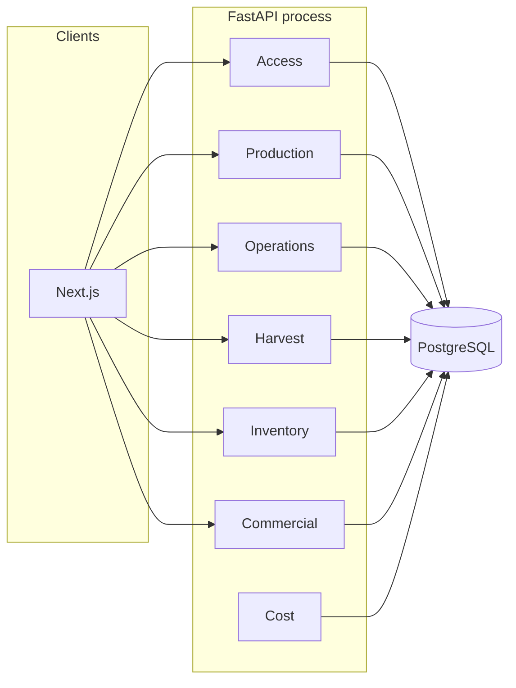

# Architecture overview

Monteiro OS is a modular monolith. One backend process and one web application are developed and deployed together. Business boundaries are modules inside those processes, not network services.

[ADR 0001](../decisions/0001-modular-monolith.md) records that choice. [ADR 0002](../decisions/0002-technology-stack.md) records the stack. Both are already reflected in the repository.

## Implemented today

```text
browser → Next.js placeholder → no business API calls
                FastAPI → PostgreSQL
```

| Piece | What exists |
| --- | --- |
| Frontend | Next.js 16 application. One placeholder page. No navigation and no domain screens. Tailwind CSS 4 is imported. No components, logo, or tokens. |
| Backend | One FastAPI process. The only route is `GET /health`. |
| Persistence | PostgreSQL 18. SQLAlchemy 2 opens a connection with `pool_pre_ping`. `Base` is an empty declarative base. Alembic is configured and `backend/alembic/versions/` has no revisions. |
| Configuration | Environment variables with local defaults. See `.env.example`. `DATABASE_URL`, when set, replaces the `POSTGRES_*` pieces. |
| Delivery | Docker Compose for the web app, API, and database. GitHub Actions jobs named `backend` and `frontend`. |
| Tests | Pytest hits a real PostgreSQL. Health returns ok when `SELECT 1` works and 503 when it does not. |

There is no account directory, no file storage, no queue, no cache, and no domain table. The planned MVP adds a single-user desktop shell and basic deployment protection, not multi-user authorization. See [ADR 0009](../decisions/0009-single-user-desktop-first.md).

Backend layout today:

```text
backend/
├── app/
│   ├── main.py           application factory
│   ├── api/              HTTP routes
│   └── core/             settings and database
├── alembic/
└── tests/
```

## Target shape

Domain code will be added inside the same processes when a feature needs it. A likely layout, created only as features land, is:

```text
backend/app/modules/<module>/
frontend/src/                  feature screens beside the existing app
```

Do not add empty module packages ahead of the feature that uses them.

Conceptual modules and the dependencies allowed between them are in [MODULE_DEPENDENCIES.md](MODULE_DEPENDENCIES.md). The entities they own are in [DATA_MODEL.md](DATA_MODEL.md).



Traceability screens read operations, harvests, and commercial links. They are not a second store of those facts.

## Principles already in force

- One repository, one backend process, one web app.
- Ordinary, boring technology. The current stack stays.
- No infrastructure without a present use. No queues, caches, brokers, or extra services are reserved for future IoT or voice features.
- Configuration and schema are versioned with the code.
- Automated checks cover lint, format, tests, and the frontend build. There is no coverage gate and no deployment workflow.

## Persistence approach

Features that introduce durable state add SQLAlchemy models on the existing `Base` and an Alembic revision reviewed in the same pull request. The migration workflow is in [WORKFLOW.md](../development/WORKFLOW.md).

The conceptual model is not a command to create one table per noun. A specification's data requirements are the business facts to persist. Physical table design happens during implementation, inside those requirements.

## File storage

TRACE-02 is the first feature that needs files. Photographs belong in an object-storage or filesystem location behind the API, with metadata in PostgreSQL. The concrete store is chosen in that feature. It is not introduced before then.

## What this architecture deliberately excludes

- Microservices and a message broker.
- A separate analytics database before there is operational data.
- Multi-tenant isolation. The product is for Monteiro.
- Treating Next.js as a second writer to PostgreSQL. The browser talks to the API.

## Relationship to the domain

Business rules live in `docs/domain/`. This overview does not restate them. Where a rule constrains the shape of the system, the decision record explains the constraint and the domain document remains the source of the rule.
